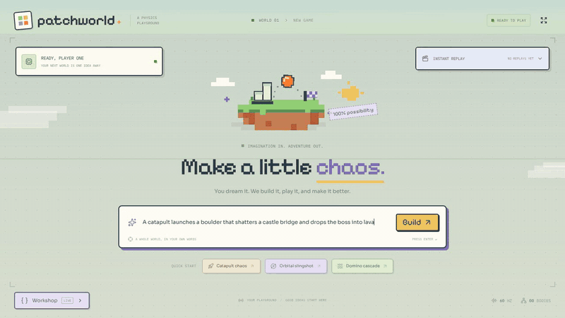

# Patchworld

**A 3D physics game engine that watches its own bot fail, then rewrites its own code.**

You describe a physical goal ("a catapult launches a boulder that shatters a castle bridge and drops the boss into lava"). Gemini writes the whole Three.js + Rapier level. A bot plays it for eight seconds while the browser records video. A Managed Agent watches that video, explains what went wrong with timestamps, and patches the code. The fix hot-reloads into the running page, and the bot tries again until the level is beaten. Then you play it.



*Track 2: More Dimensions. The GIF is a real run in mock mode at 2× speed. The 3-minute demo script is in [docs/DEMO.md](docs/DEMO.md).*

## The loop

1. **Generate.** `gemini-4-argon` writes the level in one long pass: meshes, colliders, the bot, the goal and the human controls.
2. **Check.** The local daemon typechecks the files against the engine contract before anything touches the page. Errors go back to the model for one repair pass.
3. **Hot-swap.** Vite HMR replaces the level module. The renderer, camera and WebSocket stay alive; nothing reloads.
4. **Play and record.** A bot plays for 8 seconds (480 physics ticks at 60 Hz) while `MediaRecorder` captures the canvas and the engine logs per-frame telemetry.
5. **Watch and critique.** The WebM and the telemetry go to a Managed Agent, which diagnoses failures a screenshot would miss ("at 0:03 the boulder passes straight through the bridge"). The critique streams into the corner of the screen as it is written.
6. **Patch.** The agent returns a fix, which goes back to step 2. The engine, not the level, decides whether the declared goal was reached.

## What's on screen

- **Instant replay** (top right): every attempt's video and the agent's critique as it streams in. Timestamps in the critique are buttons that jump the replay to that moment. **Draft 1 vs win** plays the first draft and the winning run side by side.
- **Workshop** (bottom left): **Terminal** shows the agent's live events and sandbox tool output; **Code** shows each iteration's generated files and the diff from the last one; **SKILL.md** shows the physics lessons the agent has learned.
- **Your turn:** once the bot wins, reset the level and play. The control bar shows the level's own controls (for example **Space**: fire the catapult) and its goal; a win or lose screen appears when you finish. **Add a twist** changes the world with a new idea.

## Run it

Needs Node 22+ and a WebGL browser.

```bash
npm install
npm run dev:mock    # recorded run, no API key, no credits
```

Open the Vite URL it prints (usually `http://localhost:5173`) in **one** tab and press **Build**. Mock mode replays a scripted catapult run through the real daemon, typecheck, hot-swap, playtest and critique path, whatever the prompt is. It's the safe way to try Patchworld and the fallback for live demos.

For live generation, add your key to a local `.env` (plain `KEY=value` lines; see `.env.example`) and run the normal dev server:

```bash
GEMINI_API_KEY=your-key   # in .env, never committed
npm run dev
```

The key is read only by the Node daemon. It never reaches the browser, generated files or logs. Restart the daemon after editing `.env`.

## Check it

```bash
npm test          # daemon, protocol and generated-file tests
npm run build     # typechecks the frontend and the daemon, then builds
npm run dry-run   # with npm run dev and the page open: a 240-frame failure, a patch over HMR, then a pass
```

## How it fits together

| Part | Where | What it does |
|---|---|---|
| Engine host | `src/engine/EngineHost.ts` | Persistent Three.js renderer and Rapier world; mounts levels, frames the camera, checks the declared goal each frame |
| Autonomous loop | `src/engine/AutonomousLoop.ts` | Bot runs, video and telemetry capture, human takeover |
| Sync daemon | `server/syncDaemon.ts` | Local WebSocket broker; typechecks and writes generated files; drives the iteration loop |
| Orchestrator | `server/argonOrchestrator.ts` | Gemini Interactions API: world generation, video upload, Managed Agent critique and patch |
| UI | `src/components/`, `src/hooks/useSandbox.ts` | Replay card, Workshop, controls, win and lose screens |

### Generated level contract

Generated modules live directly in `src/generated/`, with `activeLevel.ts` as the entry. `buildWorld(scene, world, namedBodies, eventQueue)` returns a `MountedLevel` (see `src/engine/types.ts`):

- `stepBotAndRules(frame, seconds)` and `stepHumanAndRules(frame, seconds)` return `{ botState, goalReached, failedEarly? }`.
- `controls: { key, action }[]` lists the human controls the UI shows.
- `goal` declares the win as data (`below-y`, `above-y`, `in-region` or `near-point` for a named body), which the engine checks itself.
- `onPointerOrKey(event)` handles input in human mode; `dispose()` cleans up.

Generated code never runs through `eval`, `new Function` or remote scripts, and a level is only replaced through Vite HMR.

### Playtest protocol

An agent registers on `ws://127.0.0.1:4174` with `{"type":"register","role":"agent"}` and starts a run with `{"type":"start-playtest","maxFrames":240}`. A failed run comes back as one binary packet: a 4-byte header length, the `PLAYTEST_FAILED_PAYLOAD` metadata with the frame ledger, then the WebM bytes. Patches go back as `{"type":"write-files","runId":"…","files":[{"path":"src/generated/activeLevel.ts","content":"…"}]}`; the daemon typechecks before writing, and a successful mount starts the next run. Failed runs are saved under the ignored `artifacts/playtests/`.

## Team

Amal (AI pipeline), Tanmay (daemon and reliability), Vedant (engine and physics), Prakhar (UI and demo).
